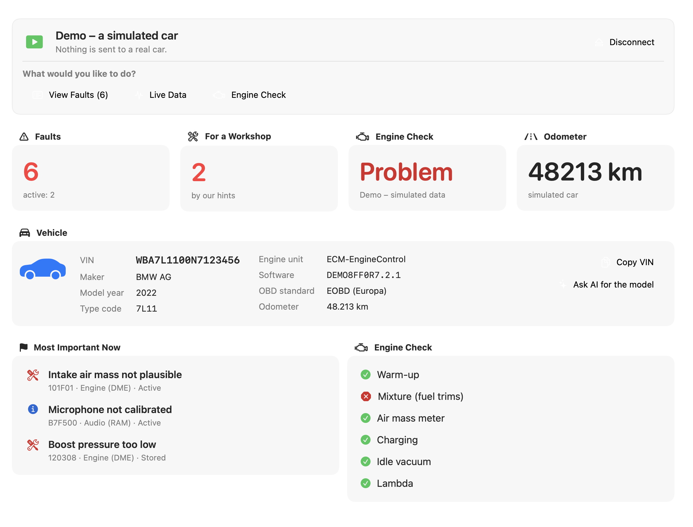
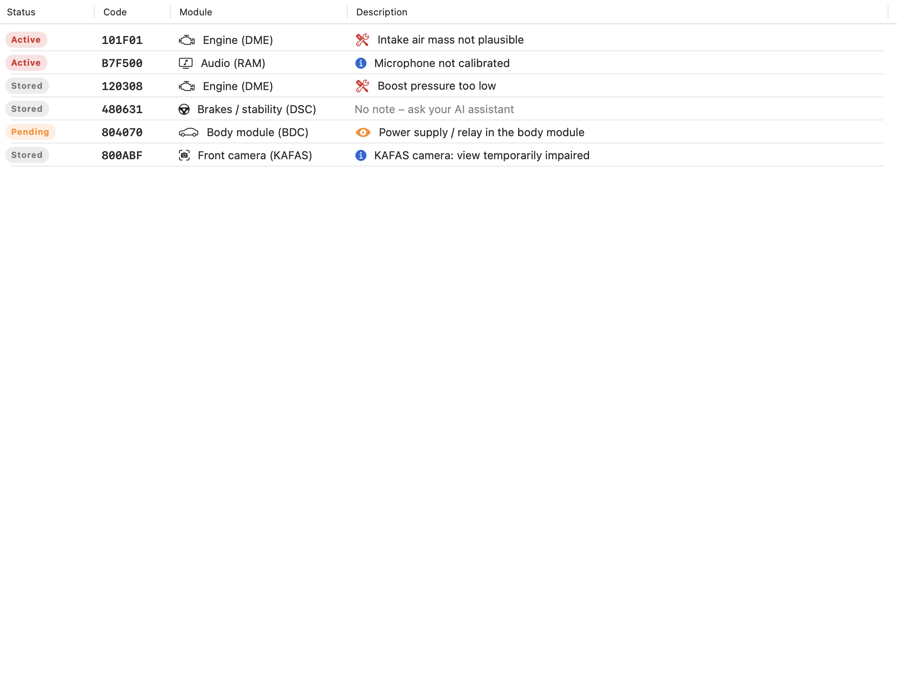
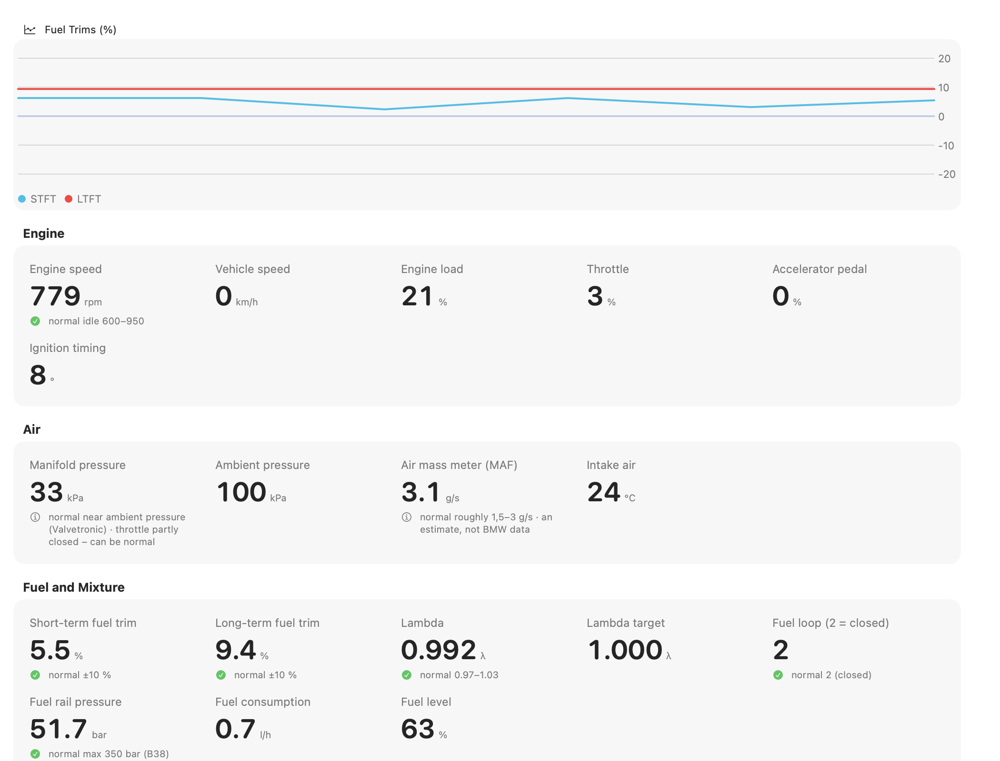
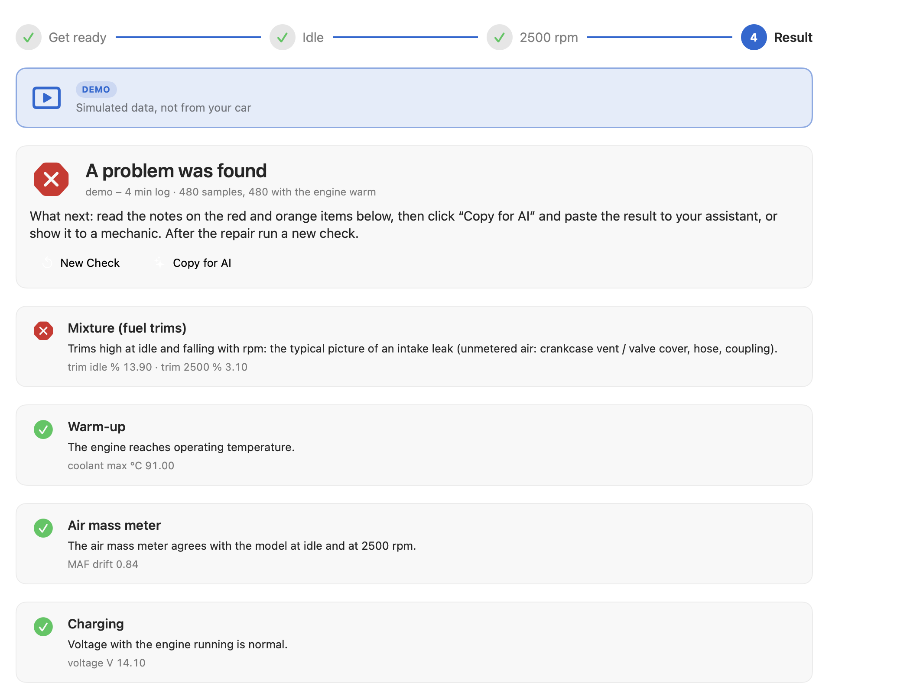
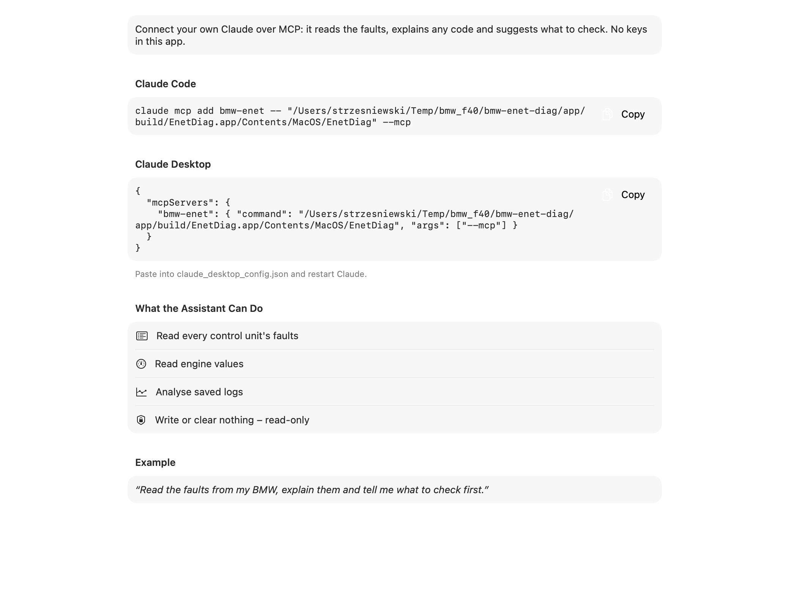

# BMW ENET Diag

**English** | [Polski](README.pl.md)

A free, native macOS app that reads your BMW's fault memory and engine data over an ENET cable, and
**cannot change anything in the car**. For F- and G-series BMWs (2012+), in English and Polish.

Plug an ENET cable (a cheap OBD-to-Ethernet cable) into the OBD port and your Mac, switch the ignition on, click Connect. You get every
control unit's faults with a plain-language hint, live engine data judged against normal ranges, a guided
engine check that tells a vacuum leak from a dirty air-mass meter, and an MCP server so your own Claude
can explain the rest.



## Why another BMW app

Most BMW apps (BimmerLink, Carly, OBDeleven, BimmerCode…) are excellent, run on a phone, use a Bluetooth
adapter and can also write to the car: clear faults, code features, run service functions. This one does
less, on purpose:

- **Read-only by construction.** One allowlist decides every byte sent to the car; it has no way to clear,
  code, flash or open a session. You can plug it into any car without worrying.
- **Native on the Mac**, over the ENET cable you may already own for E-Sys or MGU tools. No adapter, no
  account, no subscription, nothing leaves your Mac.
- **Explains, not just lists.** Each fault gets a severity (workshop / watch / info) and a short note,
  191 codes so far, mostly from BMW service bulletins.
- **Bring your own AI.** `EnetDiag --mcp` lets Claude (or any MCP client) read faults and logs. The VIN is
  redacted; there are no API keys in the app.

## What it does

| | |
|---|---|
|  | **Faults** from every control unit (`19 02` to all at once), grouped by unit, with status (active / pending / stored), freeze-frame data and a hint. Copy for AI or a workshop in one click. |
|  | **Live data** from public OBD: trims, lambda, MAF, MAP, rail pressure, temperatures, voltage, misfires per cylinder. Each value shows its normal range and a ✓ only when it can be judged (warm engine, closed loop). Pick your engine (B38, B46, B48, B58, S58, N13, N20, N55) for engine-specific limits. |
|  | **Engine check** in four steps: prepare, idle, 2500 rpm, result. It records a short log at each step and checks warm-up, mixture, air mass, charging and lambda. Valvetronic engines are handled (no false vacuum alarms). |
|  | **AI assistant**: one command to add the app to Claude Code / Claude Desktop. Tools: `read_faults`, `engine_snapshot`, `list_captures`, `read_capture`, `analyze_log`. |

Clearing faults is not in this app: use a workshop or the **Fault Scanner** in
[mgu-store](https://github.com/robertnisipeanu/mgu-store).

## Read-only, by construction

Every request passes `Allowlist.check` in `Car` (the only public way to the car) and again at the socket:

| Allowed | To |
|---|---|
| UDS `19 01/02/04/06`: read fault memory, its snapshot and extended data | every control unit, or all at once (`0xDF`) |
| OBD `01 02 03 06 07 09 0A`, UDS `22` (read by identifier) | the engine unit (`0x12`) only |

Everything else is refused before a byte goes out: clearing (`14`, OBD `04`), sessions (`10`), security access
(`27`), writes, controls and routines (`2E 2F 31`), resets, downloads. The app connects only to local
addresses (ENET link-local or private), sends one request at a time and survives a dropped connection.
Captures hold the VIN and stay in `~/Library/Application Support/EnetDiag/captures`.

## Install

Requires macOS 26 and Xcode 26 (or its command-line tools).

```
git clone https://github.com/sembsa/bmw-enet-diag
cd bmw-enet-diag/app
./make-app.sh            # -> build/EnetDiag.app (ad-hoc signed)
open build/EnetDiag.app  # Connect, or Try the Demo
swift test               # allowlist, transport (fake gateway), decoding, analysis, MCP
```

No cable yet? **Try the Demo** shows a simulated car. With the cable: ignition on (engine running for live
data). If the gateway isn't found, set its IP in Settings and allow **Local Network** for the app.

### Your own AI (MCP)

```
claude mcp add bmw-enet -- "/path/to/EnetDiag.app/Contents/MacOS/EnetDiag" --mcp
```

Stdio only, no network listener.

## Status

Tested on one car (F40, B38 1.5, 2022). Other F/G cars should work, since everything used is a public
standard (UDS, SAE J1979), but reports are welcome. The engine-specific ranges in
`research/engine_norms.json` are from public sources and marked by confidence; "roughly" values are
shown without a ✓.

## Contributing

Fault notes live in `data/known_codes.json`, each with its sources and a confidence. Add one by pull
request, then run `tools/embed-codes.sh`. Notes are written in our own words; don't paste BMW documents.

Control unit names: from cauliflowermossgrape/idrive7-apps `kit/runtime/ecus.js` (MIT).

## License

MIT. An independent project, not affiliated with BMW AG. BMW is a trademark of BMW AG. Use at your own
risk; this app is no substitute for a workshop.
