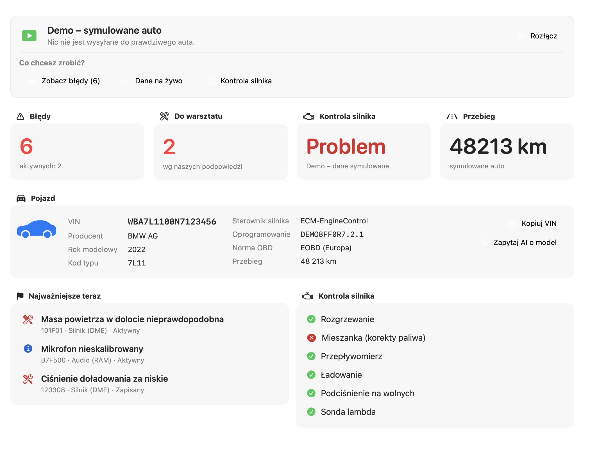
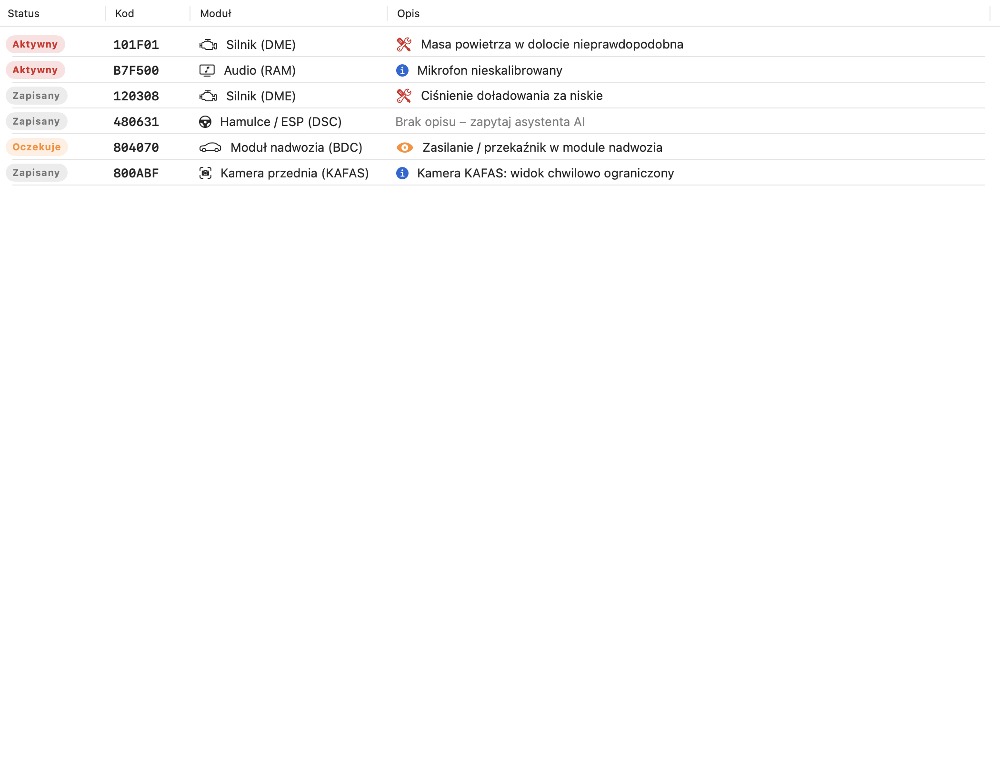
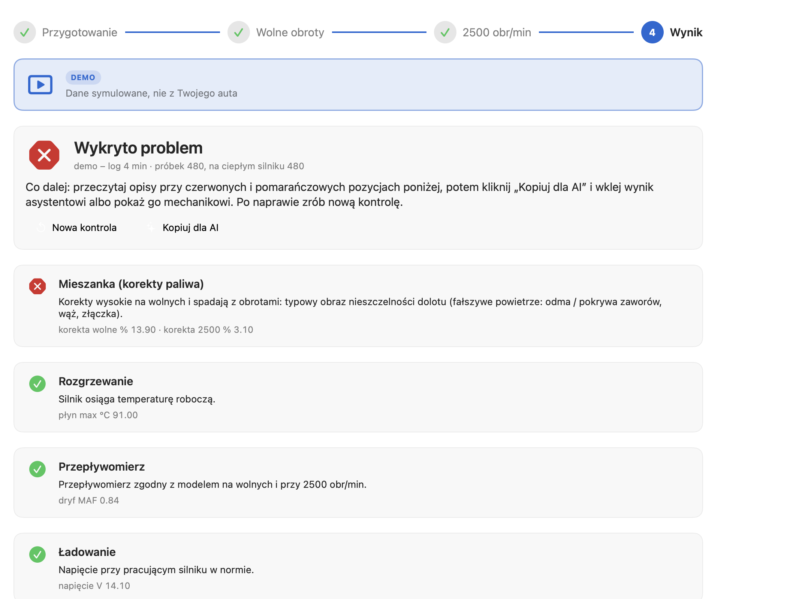
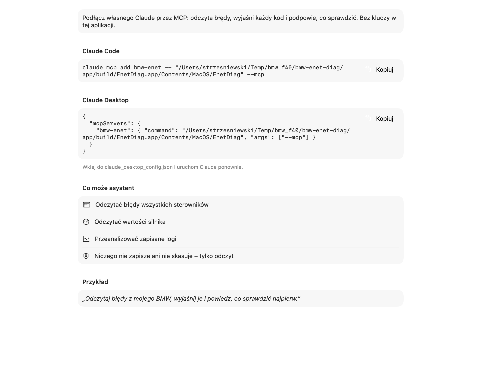

# BMW ENET Diag

[English](README.md) | **Polski**

Darmowa, natywna aplikacja na macOS, która czyta pamięć błędów i dane silnika BMW przez kabel ENET i
**nie potrafi niczego w aucie zmienić**. Dla BMW serii F i G (od 2012), po polsku i angielsku.

Wepnij kabel ENET (tani kabel OBD–Ethernet) do gniazda OBD i Maca, włącz zapłon, kliknij Połącz. Dostajesz
błędy ze wszystkich sterowników z opisem po ludzku, dane silnika na żywo z normami, prowadzoną kontrolę
silnika, która odróżnia nieszczelność dolotu od brudnego przepływomierza, oraz serwer MCP, żeby Twój własny
Claude wytłumaczył resztę.



## Po co kolejna apka do BMW

Większość aplikacji (BimmerLink, Carly, OBDeleven, BimmerCode…) jest świetna, działa na telefonie z
adapterem Bluetooth i potrafi też zapisywać do auta: kasować błędy, kodować, uruchamiać funkcje serwisowe.
Ta robi mniej, celowo:

- **Tylko odczyt, z założenia.** Jedna lista dozwolonych zapytań decyduje o każdym bajcie wysłanym do auta;
  nie ma jak skasować, zakodować, sflashować ani otworzyć sesji. Można ją podpiąć do każdego auta bez obaw.
- **Natywnie na Macu**, przez kabel ENET, który pewnie już masz do E-Sys albo narzędzi MGU. Bez adaptera,
  konta i abonamentu; nic nie wychodzi z Twojego Maca.
- **Tłumaczy, a nie tylko wypisuje.** Każdy błąd ma wagę (do warsztatu / obserwuj / informacja) i krótki
  opis; na razie 191 kodów, głównie z biuletynów serwisowych BMW.
- **Własne AI.** `EnetDiag --mcp` pozwala Claude (lub innemu klientowi MCP) czytać błędy i logi. VIN jest
  ukryty, w aplikacji nie ma żadnych kluczy API.

## Co potrafi

| | |
|---|---|
|  | **Błędy** ze wszystkich sterowników naraz, pogrupowane, ze statusem (aktywny / oczekuje / zapisany), danymi z chwili wystąpienia i podpowiedzią. Jednym kliknięciem kopia dla AI lub warsztatu. |
|  | **Na żywo** z publicznego OBD: korekty, lambda, przepływomierz, ciśnienie w kolektorze i na listwie, temperatury, napięcie, wypadanie zapłonów na cylinder. Każda wartość ma normę, a ✓ tylko gdy da się ją ocenić (ciepły silnik, pętla zamknięta). Wybierz swój silnik (B38, B46, B48, B58, S58, N13, N20, N55), żeby dostać jego limity. |
|  | **Kontrola silnika** w czterech krokach: przygotowanie, wolne obroty, 2500 obr/min, wynik. Sprawdza rozgrzewanie, mieszankę, przepływomierz, ładowanie i lambdę. Obsługuje Valvetronic (bez fałszywych alarmów o podciśnieniu). |
|  | **Asystent AI**: jedno polecenie dodaje aplikację do Claude Code / Claude Desktop. Narzędzia: `read_faults`, `engine_snapshot`, `list_captures`, `read_capture`, `analyze_log`. |

Kasowania błędów tu nie ma: warsztat albo **Fault Scanner** w
[mgu-store](https://github.com/robertnisipeanu/mgu-store).

## Instalacja

Wymaga macOS 26 i Xcode 26 (lub narzędzi wiersza poleceń).

```
git clone https://github.com/sembsa/bmw-enet-diag
cd bmw-enet-diag/app
./make-app.sh            # -> build/EnetDiag.app
open build/EnetDiag.app  # Połącz albo Wypróbuj demo
```

Bez kabla? **Wypróbuj demo** pokazuje symulowane auto. Z kablem: zapłon włączony (silnik pracuje dla danych
na żywo). Jeśli bramka się nie znajduje, wpisz jej IP w Ustawieniach i zezwól aplikacji na **Sieć lokalną**.

Szczegóły techniczne (lista dozwolonych zapytań, MCP, wkład): [README po angielsku](README.md).

## Stan

Sprawdzona na jednym aucie (F40, B38 1.5, 2022). Inne F/G powinny działać, bo wszystko opiera się na
publicznych standardach (UDS, SAE J1979); zgłoszenia mile widziane.

## Licencja

MIT. Niezależny projekt, niezwiązany z BMW AG. Używasz na własną odpowiedzialność; aplikacja nie zastępuje
warsztatu.
